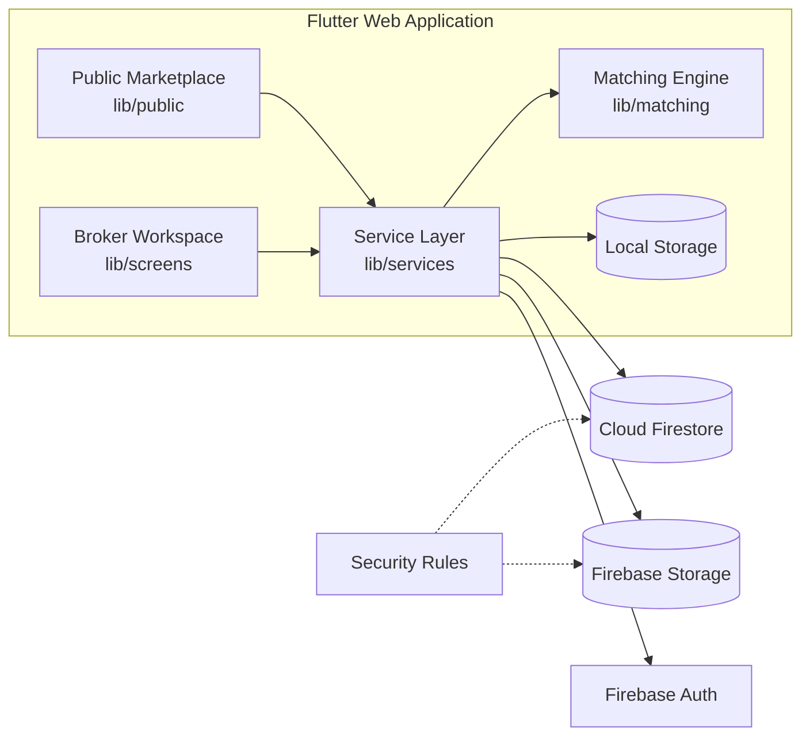

<div align="center">

# Aqarati

### Real-estate marketplace and broker management platform

An RTL-native property marketplace for the Saudi market, paired with a broker workspace that matches client demand to available listings automatically.

[](https://flutter.dev)
[](https://dart.dev)
[](https://firebase.google.com/products/firestore)
[](https://firebase.google.com/products/auth)
[](https://firebase.google.com/products/hosting)

[Overview](#overview) · [Features](#features) · [Architecture](#architecture) · [Getting Started](#getting-started) · [Deployment](#deployment) · [Security](#security-model)

</div>

---

## Overview

Aqarati is a two-sided real-estate platform built on a single Flutter Web codebase and a shared Firebase backend.

| Surface | Audience | Purpose |
|---|---|---|
| **Public marketplace** | Property seekers (no account required) | Discover, filter, compare and save listings; publish property requests; report fraudulent ads. |
| **Broker workspace** (`/admin`) | Brokers, property owners, administrators | Manage inventory, capture client demand, collaborate across agencies, record deals and monitor performance. |

The platform is built for its market: right-to-left layout throughout, Saudi cities and districts, local phone-number validation and SAR pricing.

### Highlights

- **Demand-driven matching.** A weighted scoring engine pairs client requests with listings and surfaces only high-confidence matches.
- **Cross-broker collaboration.** Brokers can borrow listings from other brokers to serve their clients, with deal confirmation by both parties.
- **Account-free browsing.** Favorites, comparisons and viewing history persist locally, so visitors can browse without signing up.
- **Role-based access.** Firestore security rules enforce listing ownership, recipient-scoped notifications and admin-only moderation.

## Features

### Public marketplace

| Capability | Description |
|---|---|
| Listing discovery | Full-text search with filters for transaction type, property type, city, price range and bedrooms. |
| Listing details | Image gallery, specifications, embedded map, view counter, availability status, WhatsApp share and copy link. |
| Map exploration | All geolocated listings on an interactive OpenStreetMap layer with price markers. |
| Comparison | Side-by-side comparison of up to four properties. |
| Favorites and history | Locally persisted favorites and recently viewed listings with live counters. |
| Property requests | Clients publish what they are looking for and brokers respond (reverse marketplace). |
| Advertiser profiles | Public broker pages with verification badge and complete listing portfolio. |
| Abuse reporting | Listings can be flagged for fraud or inaccurate data and routed to admin review. |
| Subscription tiers | Free, Basic and Premium packages with tiered listing limits and visibility. |

### Broker workspace

| Module | Description |
|---|---|
| Listings | Create and edit properties with multi-image upload and automatic coordinate extraction from Google Maps links. |
| Opportunities | Open client requests, ranked by the broker's configured coverage area. |
| Claimed requests | Requests owned by the broker, enriched with recommended matching listings from the entire network. |
| Listing borrowing | Request permission to market another broker's listing, with an accept/reject workflow. |
| Deal ledger | Record closed deals; deals on borrowed listings require confirmation from the listing owner. |
| Performance reports | KPIs for verified deals, transaction value, commission and listing engagement. |
| Notifications | In-app alerts for new matches, borrow requests and pending deal confirmations. |
| Broker profile | Contact details and coverage area (one city, up to five districts). |

### Administration

Platform-wide KPIs, user role management, broker verification and the abuse-report moderation queue.

## Tech Stack

| Layer | Technology |
|---|---|
| Framework | Flutter (Web), Material 3 |
| Language | Dart 3.11+ |
| Routing | `go_router` with deep-linkable URLs |
| Database | Cloud Firestore (real-time streams) |
| Authentication | Firebase Authentication (email and password) |
| File storage | Firebase Storage |
| Hosting | Firebase Hosting (single-page app rewrites) |
| Maps | `flutter_map`, `latlong2`, Google Static Maps API |
| Local persistence | `shared_preferences` |
| Localization | `flutter_localizations`, `intl` |

## Architecture



The codebase follows a layered structure with a strict separation between presentation and data access:

- **Presentation** (`lib/public`, `lib/screens`): stateless and stateful widgets that render reactive streams.
- **Services** (`lib/services`): the only layer that talks to Firestore, Storage, Auth and local storage.
- **Models** (`lib/models`): typed, immutable representations of Firestore documents.
- **Domain logic** (`lib/matching`): a pure, framework-independent matching engine.

## Data Model

| Collection | Description | Read | Write |
|---|---|---|---|
| `properties` | Listings, including owner, location, pricing, media and status | Public | Owner or admin |
| `requests` | Client property requests | Public (open requests) | Public create; brokers update |
| `users` | Profiles, roles, verification status and coverage area | Public | Self (excluding `role` and `verified`) or admin |
| `borrow_requests` | Inter-broker listing borrow requests | Authenticated | Authenticated |
| `deals` | Deal ledger with `verified`, `pending` and `rejected` states | Authenticated | Authenticated |
| `notifications` | In-app notifications | Recipient only | Authenticated create; recipient update |
| `reports` | Abuse reports on listings | Authenticated | Public create; admin moderation |
| `views` | Per-listing view counters | Public | Public |

## Matching Engine

Requests and listings are scored against each other on a 100-point scale. The weights are defined in [`lib/matching/matching_rules.dart`](lib/matching/matching_rules.dart) and can be changed without touching the rest of the system.

| Criterion | Weight |
|---|---:|
| City | 25 |
| Price within budget | 20 |
| Transaction type (sale or rent) | 15 |
| Property type | 15 |
| District | 15 |
| Bedrooms | 10 |
| **Total** | **100** |

Results below a score of **60** are discarded, so brokers only see relevant recommendations.

## Getting Started

### Prerequisites

| Requirement | Notes |
|---|---|
| [Flutter SDK](https://docs.flutter.dev/get-started/install) | Dart `^3.11` |
| [Firebase CLI](https://firebase.google.com/docs/cli) | For rules and hosting deployment |
| [FlutterFire CLI](https://firebase.google.com/docs/flutter/setup) | For generating Firebase configuration |
| Firebase project | Firestore, Authentication (email and password) and Storage enabled |
| Google Cloud API key | Maps Static API enabled |

### Installation

```bash
git clone https://github.com/MohamedFouad99/aqarat_panel.git
cd aqarat_panel
flutter pub get
```

### Configuration

1. **Firebase:** generate `lib/firebase_options.dart` for your own project.

   ```bash
   flutterfire configure --platforms=web
   ```

2. **Google Maps:** set your API key in [`lib/config.dart`](lib/config.dart).

   ```dart
   static const googleMapsApiKey = 'YOUR_GOOGLE_MAPS_API_KEY';
   ```

3. **Security rules:** publish the Firestore and Storage rules.

   ```bash
   firebase deploy --only firestore:rules,storage
   ```

### Running Locally

```bash
flutter run -d chrome
```

### Provisioning an Administrator

1. Register an account through `/admin`.
2. In the Firebase console, set `users/{uid}.role` to `"admin"` on that account.

Administrator privileges can only be granted from the console or by an existing administrator. Users cannot grant them to themselves from the client.

## Deployment

```bash
flutter build web --release
firebase deploy --only hosting
```

Hosting is configured in [`firebase.json`](firebase.json) to serve `build/web`, with all routes rewritten to `index.html` for client-side routing.

## Security Model

| Control | Enforcement |
|---|---|
| Listing ownership | Only the listing owner or an administrator may update or delete a listing. |
| Privilege escalation | `role` and `verified` are immutable to non-admin users. |
| Notification privacy | Notifications are readable and editable only by their recipient. |
| Moderation | Abuse reports can be resolved only by administrators. |
| Media uploads | Storage writes require authentication; reads are public. |

The Firebase web configuration and the Maps API key in client code are public identifiers by design. Access control is enforced by the security rules in [`firestore.rules`](firestore.rules) and [`storage.rules`](storage.rules). Restrict the Maps key by HTTP referrer in Google Cloud Console before going to production.

## Testing

```bash
flutter test      # widget and unit tests
flutter analyze   # static analysis
```

The test suite runs without a Firebase connection, so it can run in any CI environment.

## Project Structure

```
lib/
├── main.dart              Application bootstrap and root widget
├── router.dart            Route definitions
├── config.dart            API keys and constants
├── firebase_options.dart  Generated Firebase configuration
├── matching/              Request and listing matching engine
├── models/                Domain models
├── services/              Data access layer
├── public/                Public marketplace pages and shared widgets
├── screens/               Broker workspace and administration
├── theme/                 Design tokens and Material theme
└── utils/                 Formatting, geographic data and validators
test/                      Widget and unit tests
firestore.rules            Firestore security rules
storage.rules              Storage security rules
firebase.json              Firebase Hosting and rules configuration
```

## Roadmap

- [ ] WhatsApp assistant backed by Cloud Functions and the shared `properties` collection
- [ ] Administrator-configurable matching weights stored in Firestore
- [ ] Online payment for subscription packages
- [ ] Push notifications through Firebase Cloud Messaging
- [ ] Continuous integration for tests, analysis and preview deployments

## Contributing

1. Fork the repository and create a feature branch.
2. Make sure `flutter analyze` and `flutter test` pass.
3. Open a pull request that describes the change and its motivation.

## Author

**Mohamed Fouad**, [@MohamedFouad99](https://github.com/MohamedFouad99)
