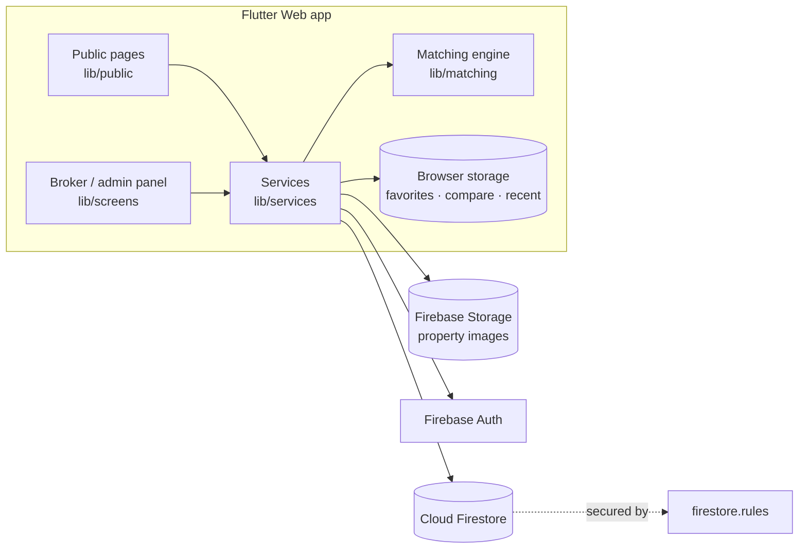

<div align="center">

# 🏠 Aqarati — عقاراتي

**A bilingual-ready, Arabic-first (RTL) real-estate marketplace and broker panel for Saudi Arabia, built with Flutter Web and Firebase.**

منصة عقارية عربية لعرض العقارات وطلبها، مع لوحة تحكم للوسطاء تربط طلبات العملاء بالعروض المناسبة تلقائياً.

[](https://flutter.dev)
[](https://dart.dev)
[](https://firebase.google.com)
[](#)

</div>

---

## Table of contents

- [Overview](#overview)
- [Features](#features)
- [Tech stack](#tech-stack)
- [Architecture](#architecture)
- [Data model](#data-model)
- [Smart matching](#smart-matching)
- [Getting started](#getting-started)
- [Deployment](#deployment)
- [Security](#security)
- [Testing](#testing)
- [Project structure](#project-structure)
- [Roadmap](#roadmap)

---

## Overview

Aqarati has two sides that share one Firestore backend:

| | Who | What they do |
|---|---|---|
| **Public site** | Visitors and clients (no login required) | Browse, search, filter, map, compare and favorite listings; post a "what I'm looking for" request; report suspicious ads. |
| **Broker panel** (`/admin`) | Brokers, owners and admins | Manage listings, claim client requests, get matched offers, borrow listings from other brokers, log deals and track KPIs. |

The whole UI is Arabic, right-to-left, and tuned for the Saudi market (Saudi cities and districts, `05xxxxxxxx` phone validation, SAR pricing).

## Features

### Public site
- **Property listings**: grid with search and filters (sale or rent, type, city, price, bedrooms).
- **Property details**: photo gallery, specs, static map, view counter, status banner, WhatsApp share and copy link.
- **Interactive map** (`/map`): every geolocated listing on an OpenStreetMap layer; tap a price pin to open it.
- **Compare** (`/compare`): side-by-side comparison of up to 4 properties.
- **Favorites and recently viewed**: stored locally in the browser, no account needed, with live counters.
- **Reverse marketplace** (`/request`): clients describe what they want and brokers respond.
- **Advertiser profiles** (`/advertiser/:name`): broker details, verified badge and all of their listings.
- **Report an ad**: flag fraud or incorrect data for admin review.
- **Packages** (`/packages`): Free, Basic and Premium subscription tiers.

### Broker panel
- **My listings**: create and edit properties with multi-image upload and Google Maps link parsing (lat/lng extraction).
- **Opportunities**: open client requests, with requests in the broker's own city and districts ranked first.
- **My requests**: requests the broker has claimed, plus recommended matching offers from all brokers.
- **Borrowing**: request to market another broker's listing; the owner accepts or rejects.
- **Deal log**: record closed deals. Deals on borrowed listings wait for the listing owner's confirmation.
- **Reports and KPIs**: verified deals, total value, commission and listing performance.
- **In-app notifications** for matches, borrow requests and deal confirmations.
- **Broker profile**: coverage area (city + up to 5 districts) that drives the opportunity ranking.

### Admin
- Platform-wide KPIs, user management (roles, verification badge), and the report moderation queue.

## Tech stack

| Layer | Technology |
|---|---|
| UI | Flutter (Web), Material 3, `google_fonts`, full RTL and `flutter_localizations` |
| Routing | `go_router` with deep-linkable URLs (`/property/:id`, `/advertiser/:name`, …) |
| Backend | Cloud Firestore, Firebase Authentication (email/password), Firebase Storage |
| Hosting | Firebase Hosting (SPA rewrite to `index.html`) |
| Maps | `flutter_map` + `latlong2` (OpenStreetMap), Google Static Maps API |
| Local state | `shared_preferences` (favorites, compare, recently viewed) |

## Architecture



- **Pages** (`lib/public`, `lib/screens`) are thin widgets that subscribe to Firestore streams through services.
- **Services** (`lib/services`) own every Firestore, Storage and Auth call, so the UI never talks to Firebase directly.
- **Models** (`lib/models`) map Firestore documents to typed Dart objects.
- **Matching** (`lib/matching`) is a standalone, rule-based scoring engine (see below).

## Data model

| Collection | Purpose | Access |
|---|---|---|
| `properties` | Listings (`ownerId`, type, city, district, price, images, location, status) | Public read · owner or admin write |
| `requests` | Client "looking for" requests | Public create · open requests are public |
| `users` | Broker profile, role, verification, coverage area | Public read · self-edit (except `role` / `verified`) |
| `borrow_requests` | Listing borrow requests between brokers | Signed-in users |
| `deals` | Closed deals log (`verified` / `pending` / `rejected`) | Signed-in users |
| `notifications` | In-app notifications (`toUid`) | Recipient only |
| `reports` | Abuse reports on listings | Public create · admin moderation |
| `views` | Per-property view counters | Public |

## Smart matching

Every client request is scored against every listing (and vice versa) with configurable weights in [`lib/matching/matching_rules.dart`](lib/matching/matching_rules.dart):

| Criterion | Weight |
|---|---:|
| City | 25 |
| Price vs. budget | 20 |
| Listing type (sale or rent) | 15 |
| Property type | 15 |
| District | 15 |
| Bedrooms | 10 |
| **Total** | **100** |

Only matches scoring **≥ 60** are shown to brokers as recommendations.

## Getting started

### Prerequisites
- [Flutter SDK](https://docs.flutter.dev/get-started/install) (Dart `^3.11`)
- A Firebase project with **Firestore**, **Authentication (Email/Password)** and **Storage** enabled
- [FlutterFire CLI](https://firebase.google.com/docs/flutter/setup) and [Firebase CLI](https://firebase.google.com/docs/cli)

### 1. Clone and install
```bash
git clone https://github.com/MohamedFouad99/aqarat_panel.git
cd aqarat_panel
flutter pub get
```

### 2. Connect your own Firebase project
```bash
flutterfire configure --platforms=web
```
This regenerates `lib/firebase_options.dart` for your project.

### 3. Set your Google Maps key
Put your own key, restricted to your domain, in [`lib/config.dart`](lib/config.dart):
```dart
static const googleMapsApiKey = 'YOUR_GOOGLE_MAPS_API_KEY';
```

### 4. Run
```bash
flutter run -d chrome
```

### 5. Create the first admin
Sign up from `/admin`, then in the Firebase console set `users/{yourUid}.role` to `"admin"`. Users can't grant themselves this role from the app.

## Deployment

```bash
flutter build web --release
firebase deploy --only hosting,firestore:rules
firebase deploy --only storage   # storage.rules
```

## Security

- **Firestore rules** ([`firestore.rules`](firestore.rules)) enforce ownership on listings, recipient-only notifications, and admin-only moderation. `role` and `verified` on user profiles can only be changed by an admin.
- **Storage rules** ([`storage.rules`](storage.rules)) allow public reads of property images and uploads by signed-in users only.
- The Firebase web config and Google Maps key in this repo are client-side identifiers that ship with every web build. Protection comes from the security rules and from **restricting the Maps key by HTTP referrer** in Google Cloud Console.

## Testing

```bash
flutter test
flutter analyze
```

The test suite runs without a Firebase connection (widget tests for the account page and unit tests for the validators).

## Project structure

```
lib/
├── main.dart                 # Firebase init, local stores, MaterialApp.router (RTL)
├── router.dart               # go_router routes
├── config.dart               # API keys / constants
├── firebase_options.dart     # generated by FlutterFire
├── matching/                 # rule-based request ↔ listing matching
├── models/                   # Property, PropertyRequest, Deal, BorrowRequest, AppNotification
├── services/                 # Firestore / Storage / Auth / local-storage services
├── public/                   # public website pages + shared widgets
├── screens/                  # broker & admin panel
├── theme/                    # colors, typography, Material theme
└── utils/                    # formatting, Saudi cities & districts, validators
```

## Roadmap

- [ ] WhatsApp bot reading the same `properties` collection through Cloud Functions
- [ ] Admin-editable matching weights stored in Firestore
- [ ] Paid subscription checkout for packages
- [ ] Push notifications (FCM)

---

<div align="center">
Built with ❤️ using Flutter & Firebase
</div>
