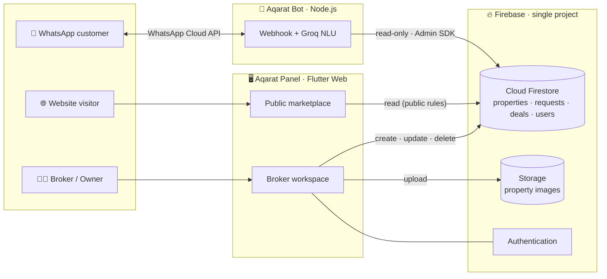
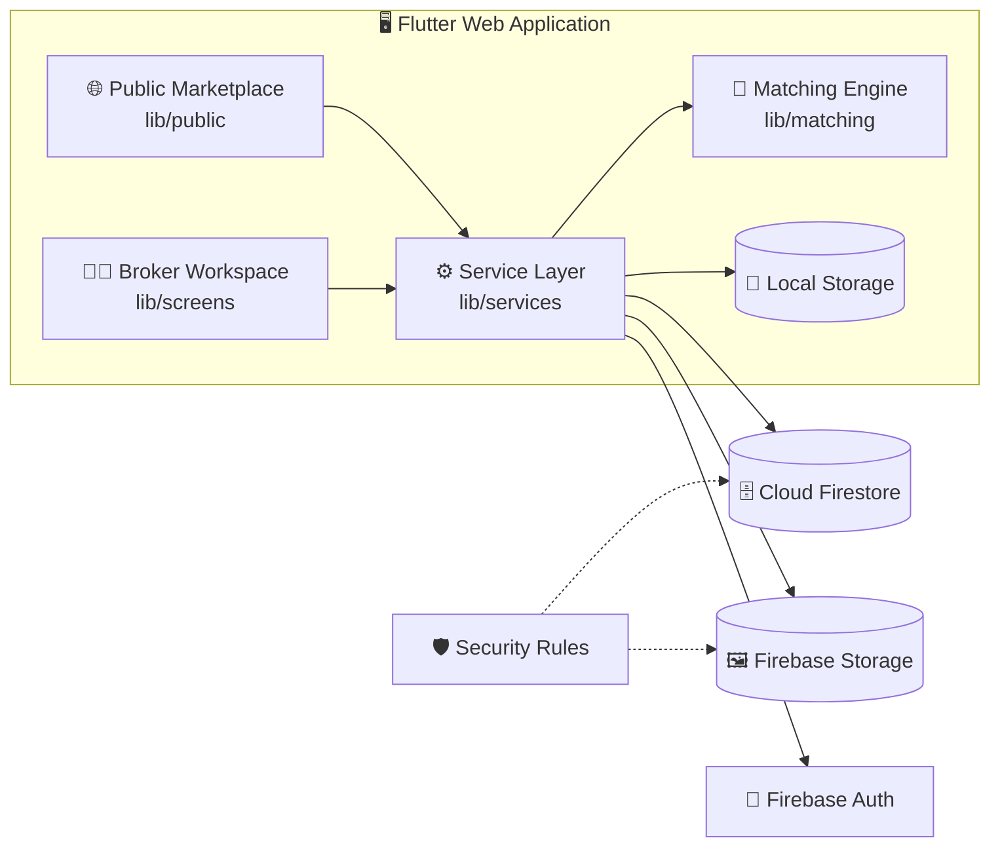

<div align="center">

# 🏙️ Aqarat Panel

### Real-estate marketplace and broker management platform

An RTL-native property marketplace for the Saudi market, paired with a broker workspace that matches client demand to listings automatically.
It is the **system of record** of the Aqarat ecosystem: every listing it manages is served instantly to customers on WhatsApp through **[Aqarat Bot](https://github.com/MohamedFouad99/aqarat_bot)**.

[](https://flutter.dev)
[](https://dart.dev)
[](https://firebase.google.com/products/firestore)
[](https://firebase.google.com/products/auth)
[](https://firebase.google.com/products/hosting)
[](https://github.com/MohamedFouad99/aqarat_bot)

[🔭 Overview](#-overview) ·
[🧩 Ecosystem](#-the-aqarat-ecosystem) ·
[✨ Features](#-features) ·
[🏗️ Architecture](#%EF%B8%8F-architecture) ·
[🚀 Getting Started](#-getting-started) ·
[🛡️ Security](#%EF%B8%8F-security-model)

</div>

---

## 📑 Table of Contents

- [🔭 Overview](#-overview)
- [🧩 The Aqarat Ecosystem](#-the-aqarat-ecosystem)
- [🤝 Integration with Aqarat Bot](#-integration-with-aqarat-bot)
- [✨ Features](#-features)
- [🧰 Tech Stack](#-tech-stack)
- [🏗️ Architecture](#%EF%B8%8F-architecture)
- [🗄️ Data Model](#%EF%B8%8F-data-model)
- [🎯 Matching Engine](#-matching-engine)
- [🚀 Getting Started](#-getting-started)
- [☁️ Deployment](#%EF%B8%8F-deployment)
- [🛡️ Security Model](#%EF%B8%8F-security-model)
- [🧪 Testing](#-testing)
- [🗂️ Project Structure](#%EF%B8%8F-project-structure)
- [🗺️ Roadmap](#%EF%B8%8F-roadmap)
- [🤲 Contributing](#-contributing)

---

## 🔭 Overview

Aqarat Panel is a two-sided real-estate platform built on a single Flutter Web codebase and a Firebase backend.

| | Surface | Audience | Purpose |
|:---:|---|---|---|
| 🌐 | **Public marketplace** | Property seekers (no account required) | Discover, filter, compare and save listings; publish property requests; report fraudulent ads |
| 🧑‍💼 | **Broker workspace** (`/admin`) | Brokers, property owners | Manage inventory, capture client demand, collaborate across agencies, record deals, track performance |
| 🛠️ | **Administration** | Platform administrators | Moderate content, verify brokers, manage roles, monitor platform KPIs |

### ⭐ Highlights

| | |
|:---:|---|
| 🎯 | **Demand-driven matching**: a weighted scoring engine pairs client requests with listings and surfaces only high-confidence matches. |
| 💬 | **Omnichannel reach**: listings published here are searchable on WhatsApp in real time through Aqarat Bot, with no sync jobs and no duplicated data. |
| 🤝 | **Cross-broker collaboration**: brokers can borrow each other's listings, and both parties confirm the resulting deal. |
| 🕶️ | **Private offers**: off-market listings stay out of the public catalog but still take part in matching. |
| 👤 | **Account-free browsing**: favorites, comparisons and viewing history persist locally in the browser. |
| 🔐 | **Role-based access**: Firestore security rules enforce ownership, privacy and admin-only moderation. |

---

## 🧩 The Aqarat Ecosystem

Aqarat is made of two independently deployed services that share **one Firebase project and one Cloud Firestore database**.

| Component | Repository | Stack | Role |
|---|---|---|---|
| 🖥️ **Aqarat Panel** | [`aqarat_panel`](https://github.com/MohamedFouad99/aqarat_panel) (this repo) | Flutter Web · Firebase | Creates and manages listings, requests, deals and users. **Owns the data.** |
| 🤖 **Aqarat Bot** | [`aqarat_bot`](https://github.com/MohamedFouad99/aqarat_bot) | Node.js · Express · WhatsApp Cloud API · Groq (Llama 3.3) | Answers customer messages on WhatsApp in natural language, using the panel's listings. **Reads the data.** |



> [!NOTE]
> Any listing a broker adds or edits in the panel is available to the bot **immediately**. The bot never writes to Firestore.

---

## 🤝 Integration with Aqarat Bot

### 📜 Shared data contract

The `properties` collection is the integration boundary. Its shape is defined by [`lib/models/property.dart`](lib/models/property.dart), and the bot depends on the following fields:

| Field | Type | Allowed values | Used by the bot for |
|---|---|---|---|
| `status` | `string` | `available` · `reserved` · `sold` | 🔎 Primary filter: only `available` listings are returned |
| `listingType` | `string` | `sale` · `rent` | Transaction-type filter |
| `type` | `string` | `apartment` · `villa` · `land` · `shop` · `office` · `building` | Property-type filter |
| `price` | `number` | — | Budget range filter |
| `bedrooms` | `number` | — | Minimum-bedrooms filter |
| `city` · `district` | `string` | — | Partial location match |
| `title` · `area` · `bathrooms` | mixed | — | Reply formatting |
| `images` | `string[]` | Firebase Storage URLs | First image sent with the result |
| `visibility` | `string` | `public` · `private` | Reserved for private offers (see below) |

> [!IMPORTANT]
> **The contract is versionless.** Renaming a field or adding an enum value (for example, a new property type) in [`property.dart`](lib/models/property.dart) must be mirrored in the bot's AI system prompt (`src/ai.js`) and label maps (`src/bot.js`). Otherwise the bot will silently stop matching those listings.

### 🔑 Access model

| Concern | Panel | Bot |
|---|---|---|
| Credentials | Firebase web config + user sign-in | Firebase **service account** (Admin SDK) |
| Security rules | Enforced by [`firestore.rules`](firestore.rules) | Bypassed by the Admin SDK by design |
| Permissions | Role-based (broker, owner, admin) | Read-only by convention |
| Firebase project | Defined in [`firebase.json`](firebase.json) | **Must be the same project** |

### ⚠️ Integration notes

- **Private offers.** The panel hides `visibility == "private"` listings from every public page. The bot does not filter on `visibility` yet, so private offers can currently appear in WhatsApp replies. Tracked on the [roadmap](#%EF%B8%8F-roadmap).
- **Status lifecycle.** Marking a listing `reserved` or `sold` in the panel removes it from bot results instantly.
- **Planned bridge.** Unmatched WhatsApp searches are intended to be written to `requests`, so they appear in the panel's opportunities marketplace for brokers to pick up.

---

## ✨ Features

### 🌐 Public marketplace

| | Capability | Description |
|:---:|---|---|
| 🔍 | Listing discovery | Search with filters for transaction type, property type, city, price range and bedrooms |
| 🏠 | Listing details | Image gallery, specifications, embedded map, view counter, availability status, WhatsApp share |
| 🗺️ | Map exploration | All geolocated listings on an interactive OpenStreetMap layer with price markers |
| ⚖️ | Comparison | Side-by-side comparison of up to four properties |
| ❤️ | Favorites and history | Locally persisted favorites and recently viewed listings with live counters |
| 📝 | Property requests | Clients publish what they want and brokers respond (reverse marketplace) |
| 🪪 | Advertiser profiles | Public broker pages with verification badge and full listing portfolio |
| 🚩 | Abuse reporting | Flag fraudulent or inaccurate listings for admin review |
| 💎 | Subscription tiers | Free, Basic and Premium packages with tiered limits and visibility |

### 🧑‍💼 Broker workspace

| | Module | Description |
|:---:|---|---|
| 🏘️ | Listings | Create and edit properties with multi-image upload, public or private visibility, and automatic coordinate extraction from Google Maps links |
| 🧭 | Opportunities | Open client requests, ranked by the broker's coverage area |
| 📋 | Claimed requests | Requests owned by the broker, with recommended listings from across the network |
| 🔁 | Listing borrowing | Request to market another broker's listing, with an accept/reject workflow |
| 🧾 | Deal ledger | Record closed deals; deals on borrowed listings need the owner's confirmation |
| 📊 | Performance reports | KPIs for verified deals, transaction value, commission and engagement |
| 🔔 | Notifications | In-app alerts for matches, borrow requests and pending deal confirmations |
| 📍 | Broker profile | Contact details and coverage area (one city, up to five districts) |

### 🛠️ Administration

📈 Platform-wide KPIs · 👥 user role management · ✅ broker verification · 🚨 abuse-report moderation queue

---

## 🧰 Tech Stack

| | Layer | Technology |
|:---:|---|---|
| 🎨 | Framework | Flutter Web, Material 3 |
| 🔤 | Language | Dart 3.11+ |
| 🧭 | Routing | `go_router` with deep-linkable URLs |
| 🗄️ | Database | Cloud Firestore (real-time streams) |
| 🔐 | Authentication | Firebase Authentication (email and password) |
| 🖼️ | File storage | Firebase Storage |
| ☁️ | Hosting | Firebase Hosting (SPA rewrites) |
| 🗺️ | Maps | `flutter_map`, `latlong2`, Google Static Maps API |
| 💾 | Local persistence | `shared_preferences` |
| 🌍 | Localization | `flutter_localizations`, `intl`, full RTL |
| 🤖 | Conversational channel | [Aqarat Bot](https://github.com/MohamedFouad99/aqarat_bot) (Node.js, WhatsApp Cloud API) |

---

## 🏗️ Architecture



| Layer | Location | Responsibility |
|---|---|---|
| 🎨 Presentation | `lib/public`, `lib/screens` | Widgets that render reactive Firestore streams |
| ⚙️ Services | `lib/services` | The only layer that talks to Firestore, Storage, Auth and local storage |
| 📦 Models | `lib/models` | Typed representations of Firestore documents (and the bot's data contract) |
| 🎯 Domain | `lib/matching` | Pure, framework-independent matching engine |

---

## 🗄️ Data Model

| Collection | Description | Read | Write | Bot |
|---|---|---|---|:---:|
| `properties` | Listings: owner, location, pricing, media, status, visibility | Public | Owner or admin | 📖 |
| `requests` | Client property requests | Public (open) | Public create · brokers update | 🔜 |
| `users` | Profiles, roles, verification, coverage area | Public | Self (except `role`, `verified`) or admin | — |
| `borrow_requests` | Inter-broker listing borrow requests | Authenticated | Authenticated | — |
| `deals` | Deal ledger (`verified` · `pending` · `rejected`) | Authenticated | Authenticated | — |
| `notifications` | In-app notifications | Recipient | Authenticated create · recipient update | — |
| `reports` | Abuse reports on listings | Authenticated | Public create · admin moderation | — |
| `views` | Per-listing view counters | Public | Public | — |

📖 read by the bot today · 🔜 planned bot integration

---

## 🎯 Matching Engine

Requests and listings are scored against each other on a 100-point scale. The weights live in [`lib/matching/matching_rules.dart`](lib/matching/matching_rules.dart) and can be tuned without touching the rest of the system.

| Criterion | Weight | |
|---|---:|---|
| 🏙️ City | 25 | `█████████████` |
| 💰 Price within budget | 20 | `██████████` |
| 🔁 Transaction type | 15 | `████████` |
| 🏠 Property type | 15 | `████████` |
| 📍 District | 15 | `████████` |
| 🛏️ Bedrooms | 10 | `█████` |
| **Total** | **100** | |

Matches scoring below **60** are discarded, so brokers only see relevant recommendations.

---

## 🚀 Getting Started

### 📋 Prerequisites

| | Requirement | Notes |
|:---:|---|---|
| 🐦 | [Flutter SDK](https://docs.flutter.dev/get-started/install) | Dart `^3.11` |
| 🔥 | [Firebase CLI](https://firebase.google.com/docs/cli) | Rules and hosting deployment |
| 🔧 | [FlutterFire CLI](https://firebase.google.com/docs/flutter/setup) | Firebase configuration generation |
| ☁️ | Firebase project | Firestore, Authentication (email and password) and Storage enabled |
| 🗺️ | Google Cloud API key | Maps Static API enabled |

### 1️⃣ Install

```bash
git clone https://github.com/MohamedFouad99/aqarat_panel.git
cd aqarat_panel
flutter pub get
```

### 2️⃣ Configure Firebase

```bash
flutterfire configure --platforms=web
```

This generates `lib/firebase_options.dart` for your project.

### 3️⃣ Configure Google Maps

Set your key in [`lib/config.dart`](lib/config.dart):

```dart
static const googleMapsApiKey = 'YOUR_GOOGLE_MAPS_API_KEY';
```

### 4️⃣ Publish security rules

```bash
firebase deploy --only firestore:rules,storage
```

### 5️⃣ Run

```bash
flutter run -d chrome
```

### 6️⃣ Provision an administrator

1. Register an account through `/admin`.
2. In the Firebase console, set `users/{uid}.role` to `"admin"`.

> [!NOTE]
> Administrator privileges can only be granted from the console or by an existing administrator. Users cannot grant them to themselves from the client.

### 7️⃣ Connect the WhatsApp bot (optional)

1. In the **same** Firebase project, open **Project settings → Service accounts → Generate new private key**.
2. Follow the [Aqarat Bot setup guide](https://github.com/MohamedFouad99/aqarat_bot#%EF%B8%8F-setup) and supply that key.
3. Add a listing with status **available** in the panel, then message the bot on WhatsApp to confirm it is returned.

---

## ☁️ Deployment

```bash
flutter build web --release
firebase deploy --only hosting
```

| Service | Platform | Deploy target |
|---|---|---|
| 🖥️ Aqarat Panel | Firebase Hosting | `build/web`, all routes rewritten to `index.html` |
| 🛡️ Security rules | Firebase | `firestore.rules`, `storage.rules` |
| 🤖 Aqarat Bot | Render (or Cloud Functions) | See the [bot deployment guide](https://github.com/MohamedFouad99/aqarat_bot#-deploying-to-render) |

---

## 🛡️ Security Model

| | Control | Enforcement |
|:---:|---|---|
| 🏠 | Listing ownership | Only the owner or an administrator may update or delete a listing |
| 🚫 | Privilege escalation | `role` and `verified` cannot be changed by non-admin users |
| 🔔 | Notification privacy | Notifications are readable and editable only by their recipient |
| 🚨 | Moderation | Abuse reports can be resolved only by administrators |
| 🖼️ | Media uploads | Storage writes require authentication; reads are public |
| 🤖 | Bot access | Server-side service account, kept outside source control |

> [!WARNING]
> The bot's service account has **full access** to the shared Firebase project and bypasses all security rules. Store it only as a server-side secret and rotate it immediately if it is ever exposed.

The Firebase web configuration and the Maps API key in client code are public identifiers by design. Access control comes from the security rules. Restrict the Maps key by HTTP referrer in Google Cloud Console before going to production.

---

## 🧪 Testing

```bash
flutter test      # widget and unit tests
flutter analyze   # static analysis
```

The test suite runs without a Firebase connection, so it can run in any CI environment.

---

## 🗂️ Project Structure

```
lib/
├── 🚀 main.dart              Application bootstrap and root widget
├── 🧭 router.dart            Route definitions
├── 🔑 config.dart            API keys and constants
├── 🔥 firebase_options.dart  Generated Firebase configuration
├── 🎯 matching/              Request and listing matching engine
├── 📦 models/                Domain models (property.dart = bot data contract)
├── ⚙️ services/              Data access layer
├── 🌐 public/                Public marketplace pages and shared widgets
├── 🧑‍💼 screens/              Broker workspace and administration
├── 🎨 theme/                 Design tokens and Material theme
└── 🧰 utils/                 Formatting, geographic data and validators
🧪 test/                      Widget and unit tests
🛡️ firestore.rules            Firestore security rules
🛡️ storage.rules              Storage security rules
☁️ firebase.json              Hosting and rules configuration
```

---

## 🗺️ Roadmap

**🖥️ Panel**
- [ ] Administrator-configurable matching weights stored in Firestore
- [ ] Online payment for subscription packages
- [ ] Push notifications through Firebase Cloud Messaging
- [ ] Continuous integration for tests, analysis and preview deployments

**🤖 Bot integration**
- [ ] Exclude private offers (`visibility == "private"`) from bot results
- [ ] Write unmatched WhatsApp searches to `requests` so they reach brokers in the panel
- [ ] Include advertiser contact details and a deep link to the listing page in bot replies
- [ ] Migrate the bot to Cloud Functions inside the same Firebase project
- [ ] Shared, versioned schema for the `properties` data contract

---

## 🤲 Contributing

1. 🍴 Fork the repository and create a feature branch.
2. ✅ Make sure `flutter analyze` and `flutter test` pass.
3. 🔗 If you change [`lib/models/property.dart`](lib/models/property.dart), open a matching change in [Aqarat Bot](https://github.com/MohamedFouad99/aqarat_bot).
4. 📬 Open a pull request that describes the change and its motivation.

---

<div align="center">

**🏙️ Part of the Aqarat ecosystem**

[🖥️ Aqarat Panel](https://github.com/MohamedFouad99/aqarat_panel) · [🤖 Aqarat Bot](https://github.com/MohamedFouad99/aqarat_bot)

Built by **[Mohamed Fouad](https://github.com/MohamedFouad99)**

</div>
